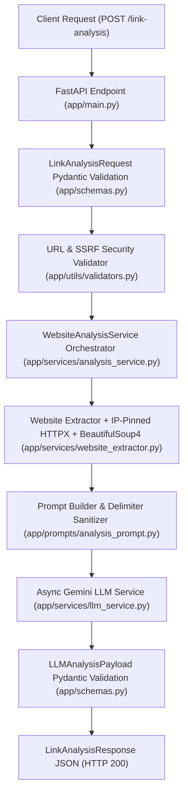

# AI-Powered Website Link Analysis API

A Python FastAPI backend that accepts a public website URL, safely extracts and cleans its HTML content, and uses Google's Gemini API to generate a structured business, competitive, SEO, search query, service, and target audience analysis.

---

## Table of Contents

1. [Project Overview](#project-overview)
2. [Key Features](#key-features)
3. [Analysis Capabilities](#analysis-capabilities)
4. [Architecture](#architecture)
5. [Technology Stack](#technology-stack)
6. [Project Structure](#project-structure)
7. [Prerequisites](#prerequisites)
8. [Installation](#installation)
9. [Environment Configuration](#environment-configuration)
10. [Running the Application](#running-the-application)
11. [Frontend Setup](#frontend-setup)
12. [API Documentation](#api-documentation)
13. [API Error Handling](#api-error-handling)
14. [Security](#security)
15. [Testing](#testing)
16. [LLM Pricing](#llm-pricing)
17. [Limitations](#limitations)
18. [Future Improvements](#future-improvements)
19. [License](#license)

---

## Project Overview

The **AI-Powered Website Link Analysis API** automates structured website research from a single URL. Given a submitted link, the service validates the URL against SSRF risks, fetches and parses the HTML page with strict size and timeout protections, builds an injection-aware analysis prompt, queries Google Gemini for structured JSON output, and validates the response against strict Pydantic v2 schemas.

**Intended Users:**

- **Business owners** seeking a fast snapshot of market positioning and SEO gaps.
- **Marketing teams** planning search discovery queries, messaging, and audience segments.
- **SEO analysts** reviewing observable on-page metadata, keyword opportunities, and content ideas.
- **Product researchers** comparing a brand against relevant AI-suggested competitors.
- **Developers** integrating structured website intelligence into backend applications.

---

## Key Features

- **Strict URL Validation & Normalization:** Enforces HTTP/HTTPS only, rejects embedded credentials, malformed hostnames, non-canonical/obfuscated IP literals, and invalid ports.
- **Defense-in-Depth SSRF Protection:** Blocks localhost, internal suffixes, private/loopback/link-local/reserved/multicast/CGNAT/NAT64 ranges, IPv4-mapped/tunneled IPv6 addresses, and cloud metadata IPs (`169.254.169.254`, etc.).
- **DNS Validation & IP-Pinned Outbound Connections:** Validates all resolved IPv4/IPv6 records and uses a custom `httpcore` network backend (`PinnedSSRFSafeBackend`) to connect directly to a validated IP literal while preserving the HTTP `Host` header and TLS SNI certificate verification.
- **Safe Manual Redirect Handling:** Disables blind automatic redirects (`follow_redirects=False`), validates every 3xx hop (up to 5 hops), and detects redirect loops.
- **Bounded HTML Extraction & Cleaning:** Uses `httpx.AsyncClient` and BeautifulSoup4 with HTML content-type enforcement, streaming byte limits (`MAX_RESPONSE_BYTES`), text length limits (`MAX_CONTENT_LENGTH`), boilerplate/hidden-DOM pruning, and metadata/heading/link/image-alt extraction.
- **Five-Section Structured AI Analysis:** Uses Google's modern `google-genai` SDK asynchronously (`client.aio.models.generate_content`) with Pydantic v2 structured output (`LLMAnalysisPayload`).
- **Fact vs. Inference Separation:** Distinguishes website-identified evidence (`website_identified`) from AI-inferred recommendations (`ai_inferred` / `ai_suggested`) and separates observable SEO issues from technical audit recommendations.
- **Resilient Error & Retry Handling:** Bounded exponential backoff with jitter and `Retry-After` support for transient Gemini failures only, plus consistent, secret-safe JSON error envelopes (`ErrorResponse`).
- **Prompt-Injection Mitigation:** Isolates untrusted webpage content inside neutralized `<UNTRUSTED_WEBSITE_DATA>` delimiters, prunes hidden HTML elements, and runs Gemini with zero tools enabled.
- **Automated Offline Test Suites:** 348 backend and 24 frontend deterministic offline tests covering validation, SSRF, extraction, schemas, prompt building, Gemini error/retry handling, configuration, CORS, API integration, cancellation, results rendering, and JSON/Markdown exports.

---

## Analysis Capabilities

`POST /link-analysis` returns brand metadata plus five structured analysis sections:

1. **Competitor vs. Brand Analysis (`competitor_analysis`):** Brand overview, relevant competitors (marked `ai_suggested` with `reason_for_similarity` and cautious `potential_weaknesses`), brand strengths, competitive advantages, market positioning, opportunities, and explicit `limitations` when website content is sparse.
2. **Target Search Queries (`target_search_queries`):** Exactly **five** unique, business-relevant search queries across supported platforms (`Google`, `Facebook`, `Instagram`, `LinkedIn`, `X`) and search intents (`Informational`, `Commercial`, `Transactional`, `Navigational`, `Business Discovery`, `Inspiration`), without fabricated search volumes or rankings.
3. **SEO Improvement Recommendations (`seo_improvements`):** Keyword recommendations (primary, secondary, long-tail, related), recommended SEO title, recommended meta description, prioritized supporting content ideas, and `seo_issues` clearly split into `observed_issues`, `recommended_improvements`, and `potential_technical_audit_items`.
4. **Top Five Services (`top_services`):** Up to five prioritized services (targeting five when supported), prioritizing `website_identified` offerings with supporting `evidence` and explicitly labeling inferred suggestions as `ai_inferred`.
5. **Target Audience Identification (`target_audience`):** Primary and secondary audiences, industries, business types, structured `customer_profiles`, needs, pain points, interests, evidence-only `geographical_focus`, recommended marketing segments, and separate `explicitly_identified_audiences` vs. `inferred_audiences`.

---

## Architecture



### Module Responsibilities

| Module | Responsibility |
| --- | --- |
| `app/main.py` | FastAPI initialization, routes (`GET /`, `GET /health`, `POST /link-analysis`), dependency providers, and exception-to-HTTP error mapping. |
| `app/config.py` | Environment variable loading via `python-dotenv` and range-validated Pydantic `Settings`. |
| `app/schemas.py` | All Pydantic v2 request, extraction, structured analysis (`LLMAnalysisPayload`, `LinkAnalysisResponse`), and error (`ErrorResponse`) models. |
| `app/utils/validators.py` | Reusable URL parsing, normalization, SSRF/IP range validation, DNS inspection, and redirect destination validation. |
| `app/services/website_extractor.py` | Async HTTPX fetching with `PinnedSSRFSafeBackend`, manual redirect loop, bounded byte streaming, BeautifulSoup4 parsing, hidden-DOM pruning, and text cleaning. |
| `app/prompts/analysis_prompt.py` | Role definition, anti-hallucination guidelines, untrusted-data delimiter sanitization, and prompt construction. |
| `app/services/llm_service.py` | Async `google-genai` integration, structured JSON enforcement, response safety/truncation inspection, bounded transient retries, and token usage logging. |
| `app/services/analysis_service.py` | Thin orchestration layer coordinating `extract_website` → `GeminiLLMService.analyze_website` → `LinkAnalysisResponse`. |

---

## Technology Stack

Verified directly against `requirements.txt`:

- **Language:** Python 3.10+ (developed and tested on Python 3.12.14)
- **Web Framework:** FastAPI (`fastapi>=0.115.0,<1.0.0`)
- **ASGI Server:** Uvicorn (`uvicorn>=0.30.0,<1.0.0`)
- **Data Validation:** Pydantic v2 (`pydantic>=2.0.0,<3.0.0`)
- **Async HTTP Client:** HTTPX (`httpx>=0.27.0,<1.0.0`) + `httpcore`
- **HTML Parsing:** BeautifulSoup4 (`beautifulsoup4>=4.12.0,<5.0.0`)
- **Environment Configuration:** `python-dotenv>=1.0.0,<2.0.0`
- **LLM SDK & Model:** Google GenAI SDK (`google-genai>=1.0.0,<2.0.0`) with Gemini API (`gemini-3.5-flash-lite` default)
- **Testing:** Pytest (`pytest>=8.0.0,<9.0.0`)

---

## Project Structure

```text
ai-website-link-analysis/
├── app/
│   ├── __init__.py
│   ├── config.py
│   ├── main.py
│   ├── schemas.py
│   ├── prompts/
│   │   ├── __init__.py
│   │   └── analysis_prompt.py
│   ├── services/
│   │   ├── __init__.py
│   │   ├── analysis_service.py
│   │   ├── llm_service.py
│   │   └── website_extractor.py
│   └── utils/
│       ├── __init__.py
│       └── validators.py
├── tests/
│   ├── __init__.py
│   ├── test_analysis_prompt.py
│   ├── test_analysis_schemas.py
│   ├── test_analysis_service.py
│   ├── test_api.py
│   ├── test_api_contract.py
│   ├── test_configuration.py
│   ├── test_extraction_edge_cases.py
│   ├── test_link_analysis_endpoint.py
│   ├── test_llm_service.py
│   ├── test_security_edge_cases.py
│   ├── test_validators.py
│   └── test_website_extractor.py
├── frontend/
│   ├── .env.example
│   ├── index.html
│   ├── package.json
│   ├── vite.config.js
│   ├── src/
│   │   ├── components/
│   │   │   ├── analysis/
│   │   │   ├── layout/
│   │   │   ├── results/
│   │   │   └── ui/
│   │   ├── context/
│   │   ├── pages/
│   │   ├── services/
│   │   └── utils/
│   └── tests/
├── .env.example
├── .gitignore
├── README.md
└── requirements.txt
```

*(Local `.env` and `venv/` directories are excluded via `.gitignore`.)*

---

## Prerequisites

- **Python:** 3.10 or newer (tested with Python 3.12.14)
- **pip:** Python package installer
- **Git:** Version control
- **Google Gemini API Key:** Required only when executing live `POST /link-analysis` calls (not required to start the server or run the offline test suite)

---

## Installation

### macOS / Linux (`zsh` / `bash`)

```bash
git clone YOUR_REPOSITORY_URL
cd ai-website-link-analysis

python3 -m venv venv
source venv/bin/activate

pip install -r requirements.txt
```

*(If your system's default `python3` is older than 3.10, substitute a newer interpreter such as `python3.12 -m venv venv`.)*

---

## Environment Configuration

Create a local `.env` file from `.env.example`:

```bash
cp .env.example .env
```

Example `.env`:

```env
APP_NAME=AI Website Link Analysis API
APP_VERSION=1.0.0
APP_DESCRIPTION=An AI-powered FastAPI backend that accepts a website URL, extracts website content, and generates structured business, competitor, SEO, search query, service, and target audience insights.

REQUEST_TIMEOUT=15
MAX_CONTENT_LENGTH=15000
MAX_RESPONSE_BYTES=2097152
USER_AGENT=AIWebsiteLinkAnalysisBot/1.0
CORS_ORIGINS=http://localhost:5173,http://127.0.0.1:5173

LLM_PROVIDER=gemini
GEMINI_MODEL=gemini-3.5-flash-lite
LLM_MODEL=
GEMINI_API_KEY=your_gemini_api_key_here

LLM_TIMEOUT_SECONDS=45
LLM_MAX_RETRIES=2
LLM_RETRY_BASE_DELAY=1.0
LLM_MAX_OUTPUT_TOKENS=4096
```

### Configuration Reference

| Variable | Required | Default | Description |
| --- | --- | --- | --- |
| `APP_NAME` | No | `AI Website Link Analysis API` | Application display name in root response and OpenAPI docs. |
| `APP_VERSION` | No | `1.0.0` | Application version metadata. |
| `APP_DESCRIPTION` | No | *(Built-in summary)* | API description shown in Swagger UI. |
| `REQUEST_TIMEOUT` | No | `15` | Website HTTP fetch timeout in seconds (`> 0`). |
| `MAX_CONTENT_LENGTH` | No | `15000` | Maximum cleaned text characters extracted for the LLM (`> 0`). |
| `MAX_RESPONSE_BYTES` | No | `2097152` | Maximum raw HTTP response download size in bytes (`2 MB`, `> 0`). |
| `USER_AGENT` | No | `AIWebsiteLinkAnalysisBot/1.0` | Honest `User-Agent` header sent during website fetching. |
| `CORS_ORIGINS` | No | `http://localhost:5173,http://127.0.0.1:5173` | Comma-separated frontend origins allowed by FastAPI CORS middleware. |
| `LLM_PROVIDER` | No | `gemini` | Configured LLM provider identifier. |
| `GEMINI_MODEL` | No | `gemini-3.5-flash-lite` | Active Gemini model ID (takes precedence over `LLM_MODEL`; never switched silently at runtime). |
| `LLM_MODEL` | No | *(empty)* | Optional legacy fallback used only when `GEMINI_MODEL` is unset. |
| `GEMINI_API_KEY` | For live analysis | *(empty)* | Google Gemini API key. App starts safely without it; missing key returns HTTP `503` when `POST /link-analysis` is invoked. |
| `LLM_TIMEOUT_SECONDS` | No | `45` | Per-attempt Gemini API timeout in seconds (`> 0`). |
| `LLM_MAX_RETRIES` | No | `2` | Maximum retry attempts on transient Gemini failures (`>= 0`). |
| `LLM_RETRY_BASE_DELAY` | No | `1.0` | Base exponential backoff delay in seconds (`>= 0`). |
| `LLM_MAX_OUTPUT_TOKENS` | No | `4096` | Maximum output tokens requested from Gemini (`> 0`). |

Never commit `.env` or hardcode API keys in source code.

---

## Running the Application

Start the FastAPI development server with Uvicorn:

```bash
uvicorn app.main:app --host 0.0.0.0 --port 4000 --reload
```

Local URLs:

- **Root Endpoint:** http://localhost:4000
- **Health Check:** http://localhost:4000/health
- **Interactive Swagger UI:** http://localhost:4000/docs
- **OpenAPI Schema:** http://localhost:4000/openapi.json

---

## Frontend Setup

The **SiteLens AI** React + Vite + Tailwind CSS frontend lives in `frontend/` and connects to the FastAPI backend (`POST /link-analysis`). It provides URL validation, request cancellation and retry handling, a structured five-section analysis dashboard, clipboard copy helpers, and client-side JSON and Markdown report export.

> **Note:** The FastAPI backend must be running separately (for example on `http://localhost:4000`) when submitting live URLs from the frontend.

### Install dependencies

```bash
cd frontend
npm install
```

### Environment

Create `frontend/.env` from `frontend/.env.example`:

```bash
cp .env.example .env
```

Configure `frontend/.env`:

```env
VITE_API_BASE_URL=http://localhost:4000
```

### Run frontend

```bash
npm run dev
```

Open **http://localhost:5173** in your browser.

### Build & test frontend

```bash
npm test
npm run build
```

---

## API Documentation

### `GET /`

Returns basic service metadata.

```json
{
  "message": "AI Website Link Analysis API",
  "version": "1.0.0",
  "status": "running"
}
```

### `GET /health`

Returns application liveness status.

```json
{
  "status": "healthy"
}
```

### `POST /link-analysis`

Accepts a public HTTP/HTTPS website URL, extracts its HTML content, and returns a validated `LinkAnalysisResponse`.

#### Request

```bash
curl -X POST http://localhost:4000/link-analysis \
  -H "Content-Type: application/json" \
  -d '{"url": "https://example.com"}'
```

```json
{
  "url": "https://example.com"
}
```

#### Example Success Response (`200 OK`)

```json
{
  "success": true,
  "website": "https://www.example.com/",
  "brand": {
    "name": "Example Cloud Analytics",
    "category": "SaaS Product Analytics",
    "summary": "Cloud analytics platform helping SaaS teams track funnels and retention cohorts.",
    "source_type": "website_identified"
  },
  "analysis": {
    "competitor_analysis": {
      "brand_overview": "Provides SaaS funnel monitoring and retention cohort dashboards.",
      "competitors": [
        {
          "name": "Mixpanel",
          "category": "Product Analytics",
          "overview": "Event-based product analytics platform for digital teams.",
          "key_strengths": ["Mature funnel reporting"],
          "potential_weaknesses": ["Usage-based pricing may increase at high event volumes"],
          "competitive_comparison": "Targets similar SaaS product and growth analytics teams.",
          "verification_status": "ai_suggested",
          "reason_for_similarity": "Overlaps on funnel tracking and retention cohort analysis."
        }
      ],
      "brand_strengths": ["Focused SaaS analytics workflows"],
      "competitive_advantages": ["Simplified cohort reporting"],
      "market_positioning": "Lightweight SaaS product analytics tool for growing teams.",
      "opportunities": ["Publish vertical SaaS retention case studies"],
      "limitations": null
    },
    "target_search_queries": [
      {
        "query": "best SaaS product analytics platform for startups",
        "platforms": ["Google", "LinkedIn"],
        "intent": "Commercial",
        "business_relevance": "Captures high-intent SaaS buyers evaluating analytics tools.",
        "target_audience": "SaaS founders",
        "source_type": "ai_inferred"
      },
      {
        "query": "how to track SaaS retention cohorts",
        "platforms": ["Google", "X"],
        "intent": "Informational",
        "business_relevance": "Connects educational searches to cohort analytics features.",
        "target_audience": "Product managers",
        "source_type": "ai_inferred"
      },
      {
        "query": "real-time SaaS funnel dashboard software",
        "platforms": ["Google"],
        "intent": "Transactional",
        "business_relevance": "Targets buyers ready to adopt a dashboard product.",
        "target_audience": "Growth leads",
        "source_type": "ai_inferred"
      },
      {
        "query": "B2B SaaS analytics vendor",
        "platforms": ["LinkedIn", "Google"],
        "intent": "Business Discovery",
        "business_relevance": "Supports vendor discovery on B2B networks.",
        "target_audience": "VP of Product",
        "source_type": "ai_inferred"
      },
      {
        "query": "SaaS retention dashboard layout examples",
        "platforms": ["Instagram", "Facebook"],
        "intent": "Inspiration",
        "business_relevance": "Attracts teams researching visual analytics dashboards.",
        "target_audience": "Growth marketers",
        "source_type": "ai_inferred"
      }
    ],
    "seo_improvements": {
      "keyword_recommendations": {
        "primary_keyword": "SaaS product analytics",
        "secondary_keywords": ["SaaS retention cohort analytics"],
        "long_tail_keywords": ["real-time funnel analytics for SaaS teams"],
        "related_keywords": ["product telemetry dashboards"]
      },
      "recommended_seo_title": {
        "recommended_title": "Example Cloud Analytics | SaaS Product & Cohort Analytics",
        "primary_keyword": "SaaS product analytics",
        "reason": "Aligns brand name with the primary commercial keyword clearly."
      },
      "recommended_meta_description": {
        "recommended_meta_description": "Monitor SaaS funnels and retention cohorts in real time with Example Cloud Analytics.",
        "target_keyword": "SaaS funnels",
        "explanation": "Concise, value-oriented description without keyword stuffing."
      },
      "supporting_content": [
        {
          "content_type": "Service page",
          "suggested_title": "SaaS Retention Cohort Analytics",
          "target_keyword": "SaaS retention cohort analytics",
          "purpose": "Capture commercial search intent for cohort reporting.",
          "target_audience": "SaaS product managers",
          "priority": "High"
        }
      ],
      "seo_issues": {
        "observed_issues": ["Homepage provides limited detail on pricing and integrations."],
        "recommended_improvements": ["Create dedicated landing pages for each core module."],
        "potential_technical_audit_items": ["Verify XML sitemap, canonical tags, and Core Web Vitals via a technical audit."]
      }
    },
    "top_services": [
      {
        "service_name": "SaaS Funnel Monitoring",
        "description": "Tracks user conversion stages across product workflows.",
        "target_industry": ["B2B SaaS"],
        "target_customer": ["Product teams"],
        "main_benefit": "Identifies conversion drop-offs rapidly.",
        "source_type": "website_identified",
        "evidence": "Helps SaaS teams track funnels and retention cohorts."
      }
    ],
    "target_audience": {
      "primary_audience": ["Growing SaaS teams", "Product managers"],
      "secondary_audience": ["RevOps analysts"],
      "industries": ["B2B SaaS"],
      "business_types": ["SaaS startups"],
      "customer_profiles": [
        {
          "audience_segment": "SaaS Growth Teams",
          "business_type": "B2B SaaS Startup",
          "industry": "Cloud Software",
          "customer_needs": ["Funnel visibility", "Retention insights"],
          "challenges": ["Manual spreadsheet reporting"],
          "relevant_services": ["SaaS Funnel Monitoring"],
          "marketing_recommendation": "Publish cohort analysis guides on LinkedIn and Google.",
          "source_type": "website_identified"
        }
      ],
      "customer_needs": ["Actionable funnel and retention visibility"],
      "customer_pain_points": ["Fragmented product telemetry"],
      "potential_interests": ["Product-led growth"],
      "geographical_focus": [],
      "recommended_marketing_segments": ["B2B SaaS Product Leaders"],
      "explicitly_identified_audiences": ["Growing SaaS teams"],
      "inferred_audiences": ["RevOps analysts"]
    }
  }
}
```

---

## API Error Handling

All error responses use the consistent `ErrorResponse` JSON envelope:

```json
{
  "success": false,
  "error": {
    "code": "WEBSITE_FETCH_FAILED",
    "message": "Unable to retrieve or parse content from the provided website."
  }
}
```

| HTTP Status | Error Code(s) | Cause |
| --- | --- | --- |
| `413` | `WEBSITE_RESPONSE_TOO_LARGE` | Declared or streamed website body exceeds `MAX_RESPONSE_BYTES`. |
| `422` | `VALIDATION_ERROR`, `UNSAFE_URL`, `UNSAFE_REDIRECT`, `UNSUPPORTED_CONTENT_TYPE` | Invalid/unsafe URL, SSRF block, unsafe redirect target, or non-HTML content type (PDF, JSON, image, binary). |
| `502` | `WEBSITE_FETCH_FAILED`, `WEBSITE_ACCESS_DENIED`, `WEBSITE_REDIRECT_FAILED`, `LLM_EMPTY_RESPONSE`, `LLM_REQUEST_REFUSED`, `LLM_INCOMPLETE_RESPONSE`, `LLM_INVALID_JSON`, `LLM_SCHEMA_VALIDATION_FAILED`, `LLM_ANALYSIS_FAILED` | Origin HTTP 4xx/5xx or SSL/network failure, redirect loop/limit exceeded, or blocked/empty/truncated/malformed Gemini output. |
| `503` | `LLM_NOT_CONFIGURED`, `LLM_AUTHENTICATION_FAILED`, `LLM_MODEL_UNAVAILABLE`, `LLM_RATE_LIMITED`, `LLM_SERVICE_UNAVAILABLE` | Missing `GEMINI_API_KEY`, invalid credentials, unavailable model, quota/rate limit, or Gemini 5xx/network failure. |
| `504` | `WEBSITE_TIMEOUT`, `LLM_TIMEOUT` | Target website fetch or Gemini request timed out. |
| `500` | `INTERNAL_SERVER_ERROR` | Unexpected internal application failure (safe generic message only). |

Raw exception tracebacks, API credentials, full prompts, and extracted webpage content are never returned in error responses.

---

## Security

- **SSRF & IP Filtering:** Rejects `localhost` variants, `.local`/`.internal`/`.localdomain` suffixes, cloud metadata hostnames and IPs (`169.254.169.254`, `169.254.170.2`, `100.100.100.200`, `fd00:ec2::254`), private/loopback/link-local/reserved/multicast/unspecified/CGNAT/NAT64 ranges, embedded IPv4-in-IPv6 (`::ffff:...`, 6to4, Teredo), IPv6 zone IDs, percent-encoded hostnames, and obfuscated IPv4 literals (integer, octal, hex, leading zeros, fullwidth Unicode).
- **DNS Validation & IP Pinning:** Inspects every IPv4 and IPv6 DNS record returned for a domain and pins TCP connections directly to a validated IP literal in `PinnedSSRFSafeBackend` while keeping the original hostname for the HTTP `Host` header and TLS SNI verification (`verify=True`, `trust_env=False`).
- **Redirect Protection:** Enforces `follow_redirects=False`, validates every redirect destination via `validate_redirect_url`, detects loops, and caps redirects at `5`.
- **Response & Text Bounds:** Checks `Content-Length` upfront and caps streamed bytes at `MAX_RESPONSE_BYTES` (stopping early even when `Content-Length` is missing, malformed, or compressed); caps cleaned text at `MAX_CONTENT_LENGTH`.
- **HTML & Prompt-Injection Mitigation:** Strips active tags (`script`, `style`, `noscript`, `iframe`, `svg`, `form`, etc.), HTML comments, and hidden DOM nodes (`hidden`, `display:none`, `visibility:hidden`); wraps untrusted webpage content in neutralized `<UNTRUSTED_WEBSITE_DATA>` delimiters; disables all Gemini tools/function calling; and validates every output with Pydantic. *Prompt injection cannot be 100% eliminated by prompting and sanitization alone.*
- **Secret-Safe Logging & Errors:** Logs only safe `scheme://hostname` (never query parameters), durations, error categories, and real provider token counts when supplied; never logs API keys, complete prompts, or full page content.

---

## Testing

Run the full offline backend test suite:

```bash
./venv/bin/pytest -v
```

- **Current verified backend status:** **348 passed, 0 failed, 0 skipped**.

Run the offline frontend test suite:

```bash
cd frontend
npm test
```

- **Current verified frontend status:** **24 passed, 0 failed, 0 skipped**.

- All unit and integration tests run **100% offline** using mocked DNS resolvers, `httpx.MockTransport`, mocked Gemini clients, mocked `fetch`, and FastAPI `dependency_overrides`.
- No real websites are accessed and no real Gemini API key or live Gemini API requests are executed during the test suites.

---

## LLM Pricing

Pricing snapshot verified against official Google documentation on **November 18, 2026**:

- **Gemini API Pricing:** https://ai.google.dev/gemini-api/docs/pricing
- **Gemini API Models:** https://ai.google.dev/gemini-api/docs/models

### Selected Model Verification

- **Default Model ID:** `gemini-3.5-flash-lite` (configurable via `GEMINI_MODEL`).
- **Status:** Stable, actively supported production model in the Gemini 3 series (1M input context window, up to 65,536 output tokens, native JSON Schema / Pydantic structured output support).
- **Why Flash-Lite fits this API:** Structured business, competitor, SEO, search query, service, and audience analysis requires reliable JSON schema adherence and low latency across high-volume text inputs at minimal token cost.

### Pricing Comparison (USD per 1 Million Tokens — Standard Paid Tier)

| Model | Model ID | Paid Input Price | Paid Output Price | Notes |
| --- | --- | --- | --- | --- |
| **Gemini 3.5 Flash-Lite** *(Default)* | `gemini-3.5-flash-lite` | \$0.30 / 1M tokens | \$2.50 / 1M tokens | Free tier available with rate limits. Output price includes thinking tokens. Context caching: \$0.03 / 1M cached input tokens (plus storage where applicable; caching is not implemented in this project). |
| **Gemini 3.1 Flash-Lite** *(Alternative)* | `gemini-3.1-flash-lite` | \$0.25 / 1M tokens | \$1.50 / 1M tokens | Lower-cost lightweight alternative; free tier listed subject to rate limits. |

### Important Pricing & Tier Caveats

- **Not unconditionally free:** The Free Tier is subject to strict rate limits, regional availability, and model access restrictions. Higher-volume or production workloads require a Paid Tier billing account.
- **Data usage distinction:** Per Google's official pricing terms, **Free Tier** inputs and outputs may be used by Google to improve its products, whereas **Paid Tier** data is **not** used to improve Google's products.
- **Subject to change:** All prices above reflect the November 18, 2026 snapshot and may change over time. Always verify current rates on the official Gemini API Pricing page.

---

## Limitations

- **Static HTML extraction only:** JavaScript-rendered Single Page Applications (SPAs) that populate content client-side may expose minimal text without a headless browser.
- **AI inference accuracy:** Competitor suggestions, audience profiles, and SEO advice are AI-generated from extracted page text and may contain inaccuracies; they do not represent live market or search-volume research.
- **Prompt injection cannot be fully eliminated:** Sanitization, delimiter isolation, hidden-DOM pruning, zero-tool execution, and Pydantic validation reduce risk significantly, but visible adversarial webpage copy can still attempt semantic manipulation.
- **No authentication:** The API does not currently implement API keys, OAuth, or user authentication.
- **No client-level rate limiting:** Incoming caller rate limiting is not implemented.
- **Live Gemini smoke testing pending:** All 348 backend and 24 frontend verified tests use offline mocks; live end-to-end validation with a real Gemini API key has not yet been run.
- **Synchronous DNS validation in Pydantic:** `LinkAnalysisRequest` invokes blocking `socket.getaddrinfo` during request parsing, which can block the ASGI event loop under slow or hanging DNS queries at high concurrency.
- **Worst-case retry latency:** Per-attempt Gemini timeouts (`45s`) combined with up to `2` retries and `Retry-After` delays (capped at `30s` each) can create high tail latency during sustained provider outages.
- **Not production-hardened as-is:** Public multi-tenant deployment requires additional hardening (network egress firewalling, authentication, rate limiting, async DNS, and observability).

---

## Future Improvements

The following enhancements are planned for future iterations and are **not currently implemented**:

- Move DNS validation out of synchronous Pydantic validators into an async resolver (`anyio.to_thread` / `aiodns`).
- Enforce an overall request/retry deadline budget across extraction and LLM retries.
- Manage a shared `google-genai` async client via FastAPI `lifespan` for connection reuse.
- Add API authentication and per-client rate limiting.
- Run live end-to-end integration smoke tests against real websites and Gemini.
- Add containerization, deployment configuration, structured observability, and monitoring.
- Add optional headless-browser rendering for JavaScript-heavy websites.
- Expand technical SEO auditing and deterministic on-page scoring metrics.

---

## License

No license file (`LICENSE`) has been added to this repository yet. Licensing terms have not yet been specified.
